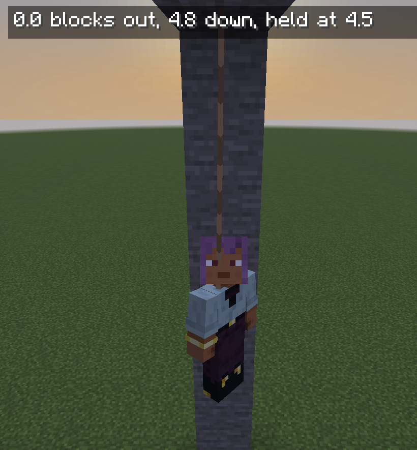

# Lead Line

A lead tied to a post, or shot on an arrow, to measure by, walk a circle round, rappel on and climb.

## Screenshots

## Measuring

Tie a lead to a fence the way [Fence Posts](https://github.com/fatlard1993/fence-posts) ties one, a lead in hand and the fence clicked, and walk away holding the other end. You are told how far out you are from the post, and how far above or below it: pace out a wall, a courtyard, the gap between two towers. With [Block Tip](https://github.com/fatlard1993/block-tip) 1.2 or later the reading stays up on its card, under whatever it is naming; without it, on the action bar.

The lead runs up to 48 blocks from the post before it snaps, rather than vanilla's twelve.

## Holding It At A Length

Press **K** (rebindable, under Pandorical) and the lead is held at the length it runs now; press it again to let it run free. `/lead hold` does the same, and `/lead hold <length>` holds it at a length you name.

Held, the lead will not let you past its length: walk it taut round the post and you walk a perfect circle, which is how a round tower, a fountain or a dome's footprint gets laid out.

## Rappelling

Hold the lead at a length at the top of a drop, and step off. You hang from it. Each **jump** lets the lead run a step and drops you a block and a half down the wall; hold **sneak** to grip it and climb back up. A lead held at a length takes the fall out of whatever it catches, so it hurts no more than a ladder does. Against a wall works the same as hanging free.

## Lead Arrows

A lead and an arrow, crafted together, make a lead arrow (three of each in a [Fletch Craft](https://github.com/fatlard1993/fletch-craft) fletching table make three). Any bow or crossbow fires it. Where it sticks, its lead runs back to your hand, held at the length it flew: shoot it into a ceiling, the underside of a bridge or the lip of a ledge, and **sneak** to climb it, the way you climb a lead from a post. Jump to let it run a step, press **K** to let it run free, and walk it round to measure as with any other.

It ties to a block within 46 blocks of you; farther, it lands as a lead arrow to fetch. A new lead arrow lets go of whatever lead you held before it, from a post or another arrow.

Click a fence with an arrow's lead in hand and it is tied off there, running from the arrow to the fence: a fixed rope up a cliff, across a gap, wherever the arrow went, out to 48 blocks. Click the knot to take it back in hand.

## Climbing A Tied Rope

A rope tied off at both ends, an arrow's lead tied to a fence or a lead from one post to another, is climbed the way a lead in hand is. **Sneak** within reach of it to take hold where you are, and keep holding sneak to climb toward its high end; let go of sneak and it still holds you. Each **jump** lets you down a step, and a jump past its foot drops you off the end. Press **K** to let go. Where a lead in hand lets you swing anywhere within its length, a tied rope keeps you on its line: up a cliff, along the underside of a bridge, or across a gap hand over hand.

Shoot a lead arrow at a creature that can wear a lead and it comes away on yours, unhurt, the way a lead put on by hand would; the arrow drops beside it, a plain one. Past twelve blocks, as far as a lead reaches a creature, or at one already on somebody's lead, it glances off and drops as a lead arrow still.

The lead lives in the arrow. Walk up and take the arrow back and its lead comes with it, as one lead arrow; break the block it is stuck in and it falls, still a lead arrow. While you hang on it, though, it stays in: you cannot pull it out from under yourself, and nobody else can pull it out from under you. Tied off at a fence, anyone may take it back, lead and all. Only a lead that snaps, walked past 48 blocks, drops the lead itself, leaving a plain arrow behind.

## Villagers And Piglins

Villagers, wandering traders, zombie villagers and piglins wear a lead here, which vanilla will not let them: walk a villager to a trading hall, lead a zombie villager off to be cured, or a piglin to where it barters. A lead goes on them by hand or on a lead arrow. A zombie villager on a lead still means you harm, and a piglin led out of the Nether still turns zombie there; piglin brutes take no lead.

## Letting Go

Right-click the post you tied it to with an empty hand and the lead comes off it, dropped at the post, the way Fence Posts unties one. Break the post, or walk past 48 blocks, and it drops too.

A lead arrow's lead ends with the session: after a restart, a stuck lead arrow is only an arrow to fetch.

## Requirements

[Fence Posts](https://github.com/fatlard1993/fence-posts) 3.1 or later, which does the tying, and Pandorical, on the server and every client. A held length is kept through a restart.

## License

MIT, see [LICENSE](LICENSE).
